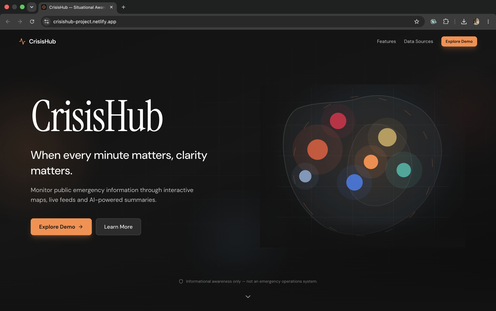

# CrisisHub

**Monitor. Understand. Visualize. Summarize.**

CrisisHub brings public emergency information into one clear dashboard — maps, live feeds, weather, and AI summaries.

It is for situational awareness only. It does **not** run emergency operations, give evacuation instructions, or replace official services.

## What you can do

- Explore hazards on an interactive map
- Follow a live incident feed
- Check weather and nearby facilities for a city or country
- Generate a short AI situation summary
- Browse statistics and data sources

## Live demo

https://crisishub-project.netlify.app

## Note

Data comes from public feeds (earthquakes, wildfires, weather, and more). Always verify critical information with official sources.

Educational project — respect upstream data provider terms of use.

